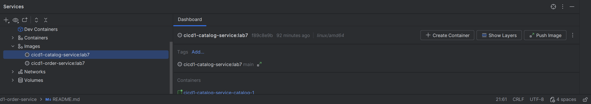

# Review and Submit - Lab 7

Why must Maven package run before docker build with the Dockerfile used here?
- Dockerfile doesnt run Maven, so without the JAR file it wouldnt work

What is the difference between an image and a running container?
- Images are reuseable, and a container runs whats created from the image.

What does 8082:8082 mean? Does EXPOSE 8082 alone make the application accessible from Windows?
- Port 8082 connects to container Port 8082. Expose only tells the port name

Why might a Feign request to localhost:8081 fail when Order is running in its own container?
- Theyre on different ports

Why did the Catalog Product survive after docker compose down and up -d? What would happen with an in-memory
H2 database?
- Volume reuses the container

Catalog product returned after docker compose down and up -d: id 1, name "calculator" id 2, name "book" id 3, name "computer"
